<div align="center">

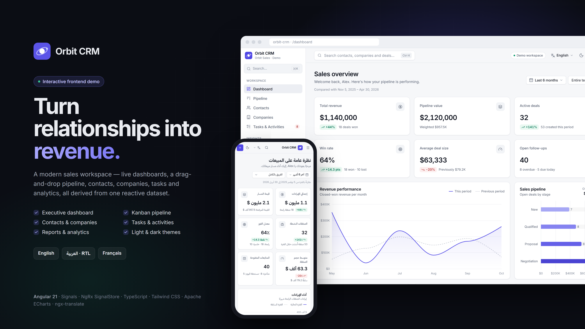

# Orbit CRM

**Turn relationships into revenue.**

A modern, multilingual sales workspace — executive dashboards, a drag-and-drop pipeline, contacts,
companies, tasks and analytics — built with Angular 21, Signals, NgRx SignalStore and Apache ECharts.

English · العربية (full RTL) · Français

**[Live demo → orbit-crm-demo.vercel.app](https://orbit-crm-demo.vercel.app)**

</div>

> **Portfolio demo.** Orbit CRM is a frontend-only application. It runs entirely in the browser
> with a deterministic seeded dataset persisted to `localStorage` — no backend, account or API keys.

---

## Highlights

- **Executive dashboard** — six KPIs with honest period-over-period comparisons, revenue
  performance, pipeline by stage, lead sources, monthly wins, team quota attainment and a live
  activity feed. Date ranges and team filter apply to everything.
- **Sales pipeline** — Kanban board with CDK drag & drop (works in RTL and on touch), a keyboard /
  touch "Move to" menu, undo, search, owner/priority/stage filters, sorting and a list view.
- **Deal details** — stage stepper, win probability and weighted value, notes, tasks, company and
  contact links, and an activity timeline.
- **Contacts & companies** — searchable, filterable, sortable, paginated directories with rich
  profiles, validated create/edit forms and safe deletes that unlink rather than destroy related
  records.
- **Tasks & activities** — overdue / today / upcoming grouping, one-click completion with undo,
  weekly summary and recently completed timeline.
- **Reports & analytics** — revenue trend, cohort conversion funnel, pipeline analysis, deal-size
  distribution, salesperson performance and lead-source insights, filterable by period, owner and
  source.
- **Multilingual by design** — runtime switching between English, Arabic and French without a
  reload, full RTL layout, CLDR plurals, locale-aware dates, numbers and currency, translated charts.
- **Product polish** — light & dark themes, ⌘K command palette, skeleton loading, empty states,
  toasts, animated KPIs, reduced-motion support, responsive layouts from 390 px to wide desktop.

## Screenshots

| | |
| --- | --- |
|  | 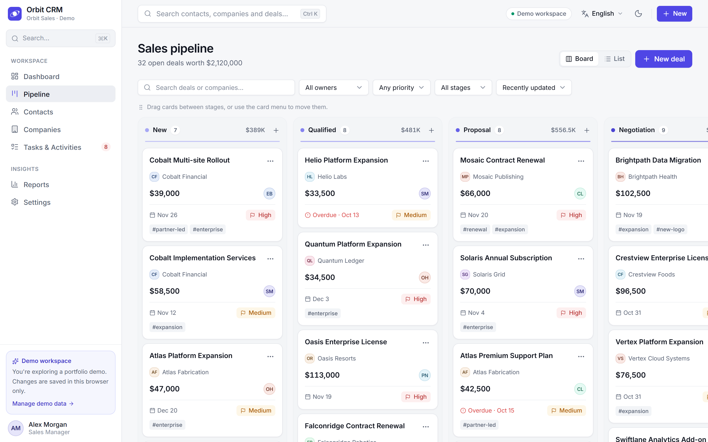 |
| 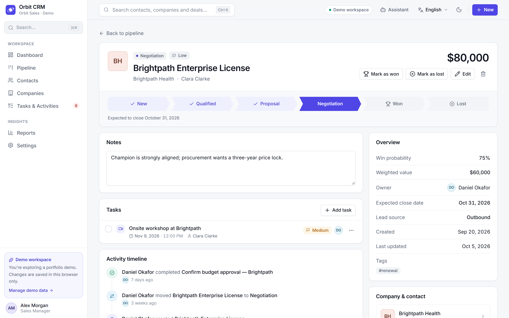 | 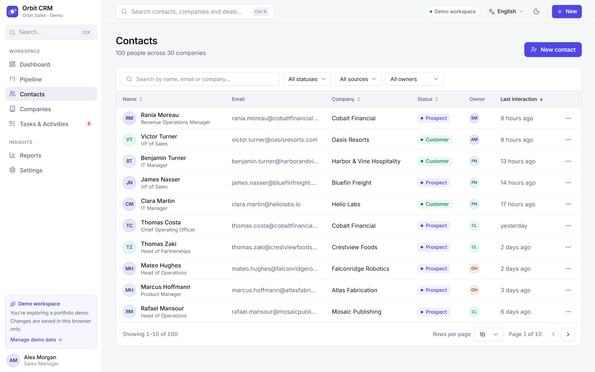 |
| 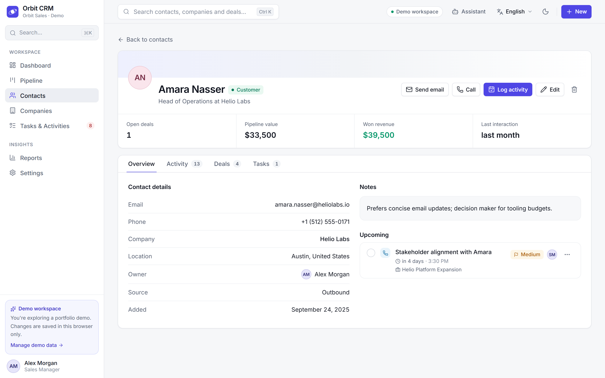 | 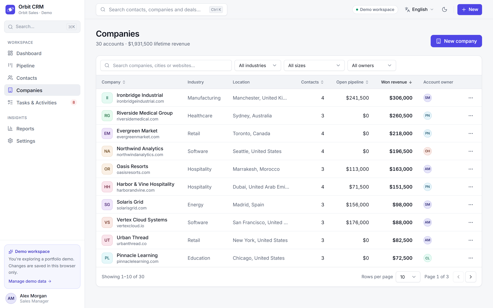 |
| 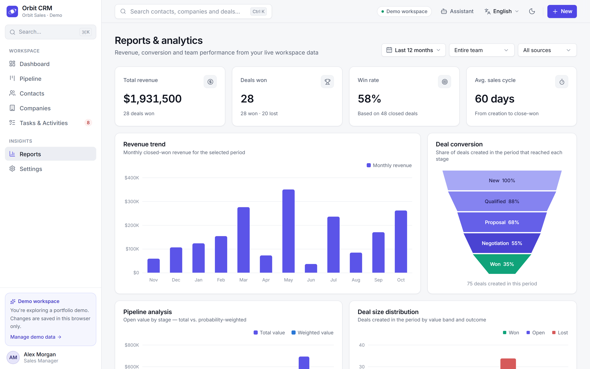 | 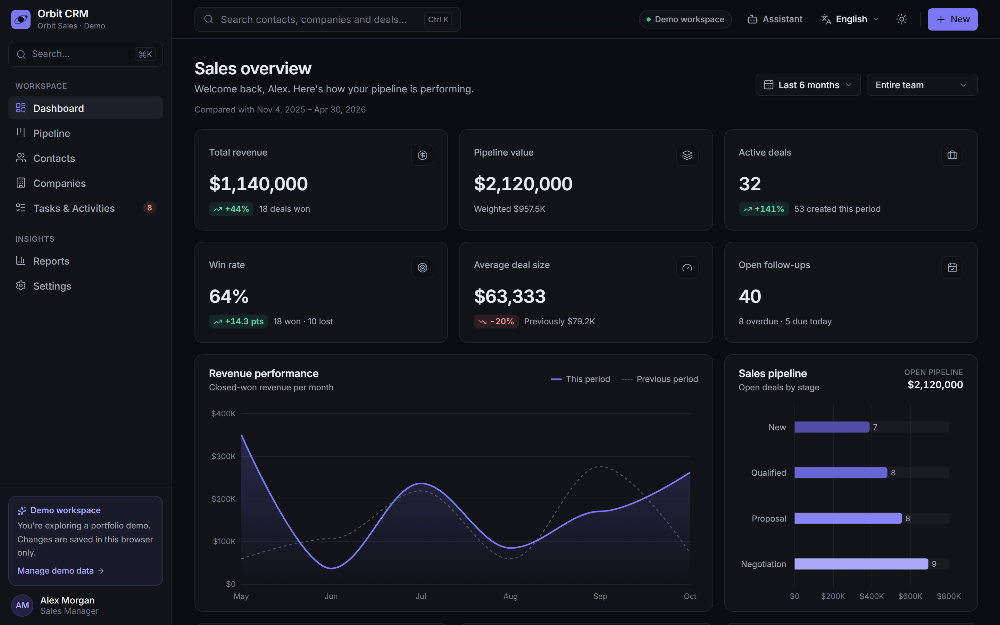 |
| 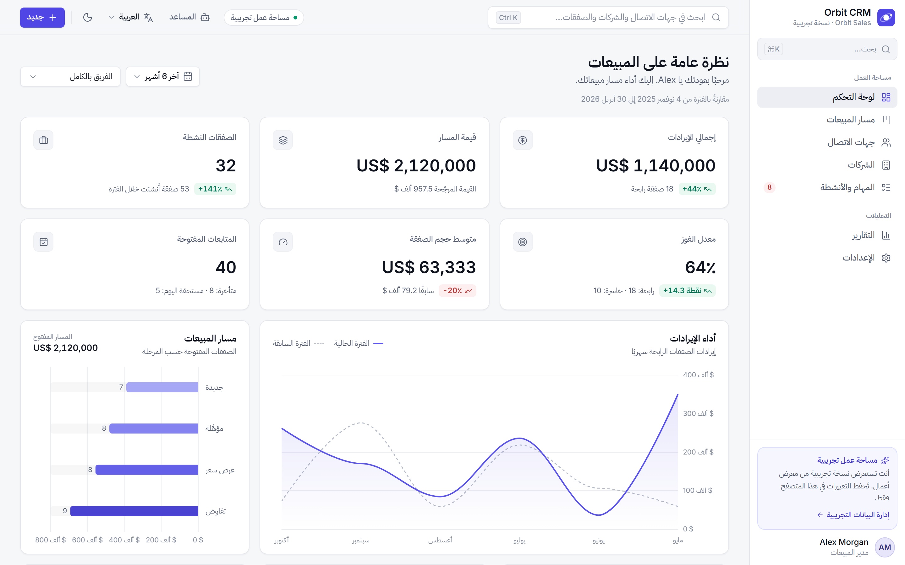 | 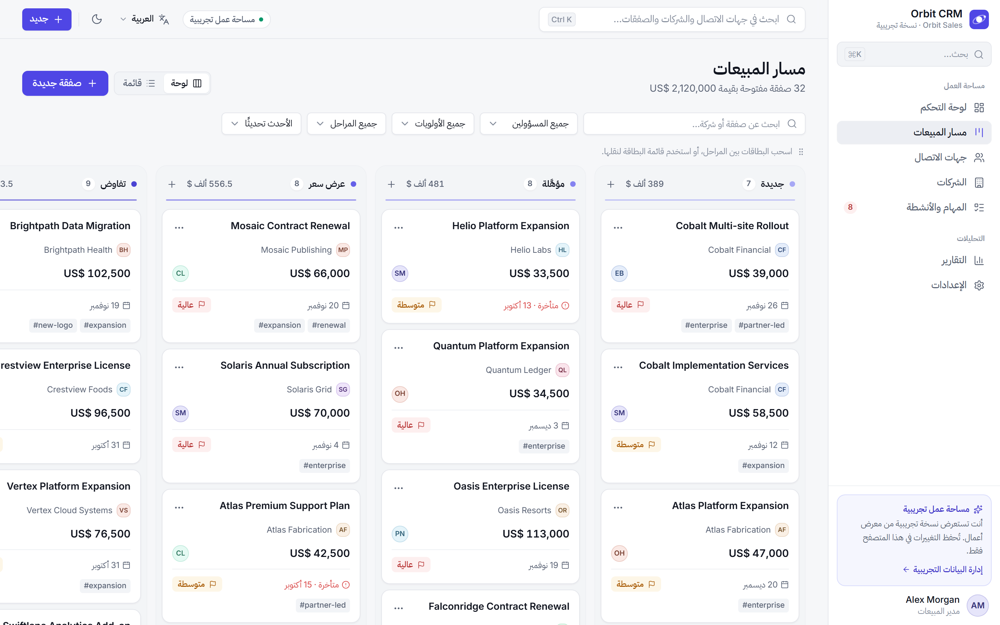 |
| 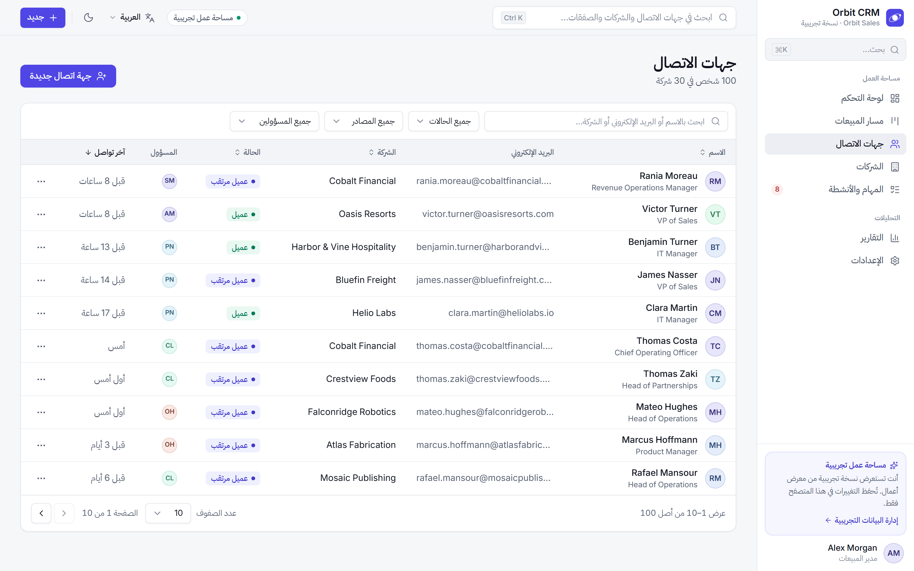 | 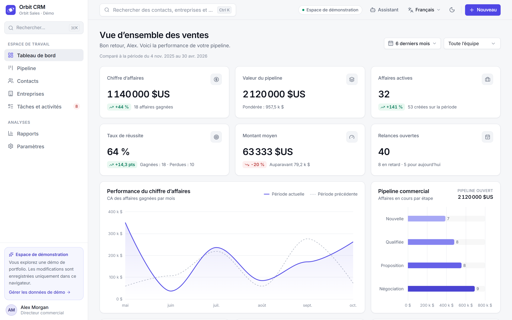 |

<p align="center">
  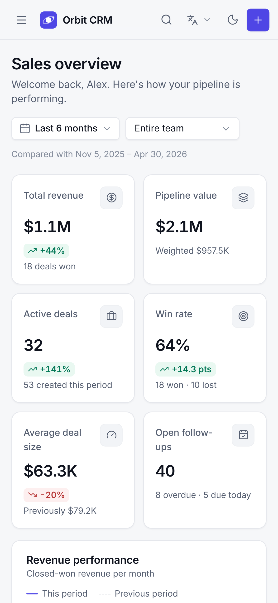
  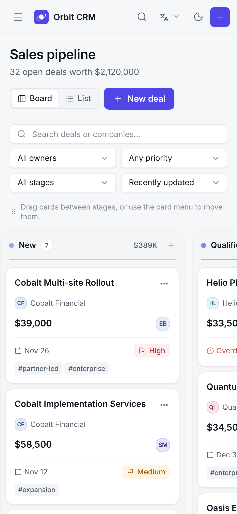
  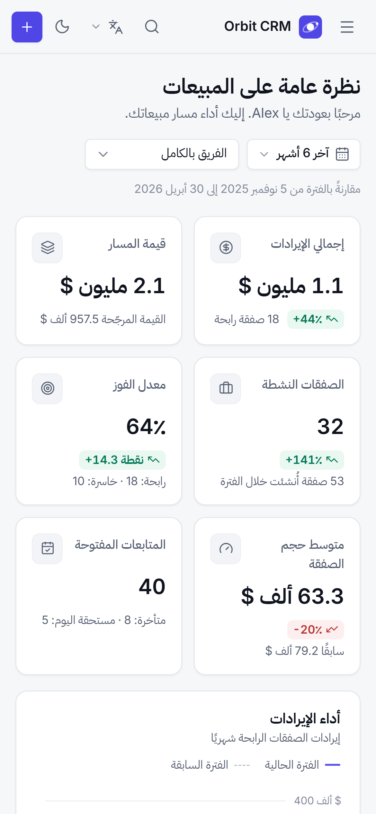
</p>

**Videos:** [`portfolio/videos/orbit-crm-walkthrough.mp4`](portfolio/videos/orbit-crm-walkthrough.mp4)
(1920×1080, 72 s) · [`portfolio/videos/orbit-crm-short.mp4`](portfolio/videos/orbit-crm-short.mp4)
(1080×1920, 26 s). Both were recorded from the running production build.

## Tech stack

| | |
| --- | --- |
| Framework | Angular 21.2 — standalone components, zoneless change detection, OnPush, lazy routes |
| State | Angular Signals, NgRx SignalStore 21 (entities + a custom optimistic CRUD feature) |
| Forms | Angular Signal Forms with translated validation messages |
| UI | Tailwind CSS 4 design tokens, Angular CDK (Dialog, Menu, Overlay, Drag & Drop, Bidi, A11y), Lucide icons |
| Charts | Apache ECharts 6 (tree-shaken, SVG renderer, lazy-loaded) |
| i18n | ngx-translate 18, `Intl` formatting, `Intl.PluralRules` |
| Quality | TypeScript strict, angular-eslint, Vitest, Playwright |

## Getting started

Requirements: **Node.js ≥ 20.19** (tested with Node 24) and npm.

```bash
npm install
npm start          # http://localhost:4200
```

The first visit seeds the demo workspace in your browser. No environment variables or external
services are required.

## Scripts

| Script | Purpose |
| --- | --- |
| `npm start` | Development server |
| `npm run build` | Production build → `dist/orbit-crm/browser` |
| `npm run serve:dist` | Serve the production build with SPA fallback on port 4310 |
| `npm run test:ci` | Unit tests (Vitest), single run |
| `npm run e2e` | Production build + Playwright E2E (desktop and mobile projects); set `E2E_BASE_URL` to test a deployed site |
| `npm run lint` / `npm run typecheck` | ESLint and TypeScript checks (app + specs) |
| `npm run i18n:check` | Translation key/plural/placeholder parity and usage scan |
| `npm run icons:check` | Verifies every referenced icon is registered |
| `npm run check` | Typecheck, lint, i18n, icons and unit tests together |
| `npm run media` | Rebuild and regenerate screenshots, cover/poster and videos |

First-time E2E/media runs need a browser: `npx playwright install chromium`.

## Architecture

Feature-oriented structure (`core/`, `shared/`, `state/`, `features/`). Components read signals from
NgRx SignalStores; cross-entity writes go through a single `CrmService`; persistence sits behind
repository contracts (abstract classes used as DI tokens) with a `localStorage` implementation that
can be swapped for HTTP without changing the UI. Analytics are pure functions wrapped in `computed`,
so moving a deal to *Won* re-derives every KPI and chart.

See **[docs/ARCHITECTURE.md](docs/ARCHITECTURE.md)** for decisions and data flow, and
**[docs/METRICS.md](docs/METRICS.md)** for metric definitions and dataset assumptions.

## Demo data & reset

- Deterministic seed (fixed PRNG seed) with 8 team members, 30 fictional companies, 100 contacts,
  80 deals, 120 activities and ~360 timeline events spanning 12 months. Dates are anchored to the
  day the workspace is first seeded, so the demo always looks current.
- Every change persists in `localStorage` and survives reloads. Corrupted or outdated stored data
  is detected, repaired where possible, or replaced by the seed — and the visitor is told.
- **Settings → Demo data → Reset demo data** restores the original dataset. Theme, language and
  layout preferences are stored separately and are kept. You can also export the workspace as JSON.

## Internationalisation

English (default), Arabic (RTL) and French dictionaries live in `public/i18n/*.json`, organised by
feature. The language selector is in the top bar and in Settings; the choice persists and applies
instantly without losing filters or records. Arabic gets a mirrored layout built on CSS logical
properties, IBM Plex Sans Arabic typography, mirrored chart axes, direction-aware icons and isolated
LTR content (emails, phones, URLs, currency symbols). Monetary values are always USD — switching
language never converts amounts.

## Testing

- **71 unit tests** — KPI/revenue/win-rate definitions, comparability rules, pipeline movement,
  task rules, seed determinism and integrity, persistence/reset/recovery, CRUD and cascades,
  language service and plurals, dictionary parity, form validation in three languages.
- **22 E2E tests** on the production build — including drag-and-drop to Won updating the
  dashboard, keyboard alternative with undo, contact and task flows, persistence and reset, RTL
  switching and RTL drag-and-drop, translated charts/dialogs/toasts, and mobile navigation. Each
  test fails on any browser console error.

## Deployment (Vercel)

The repository includes `vercel.json` (Angular preset, `npm run build`, output
`dist/orbit-crm/browser`, SPA rewrite to `index.html`, long-term caching for hashed assets).

The live demo is deployed from this repository: **https://orbit-crm-demo.vercel.app**. Every push
to `main` triggers a production deployment through Vercel’s GitHub integration.

To deploy your own copy:

1. Fork or push the repository to GitHub.
2. Import it in Vercel — no environment variables are needed.
3. Deploy. Any static host works the same way: serve `dist/orbit-crm/browser` with a fallback to
   `index.html`.

To run the E2E suite against a deployed site: `E2E_BASE_URL=https://orbit-crm-demo.vercel.app npx playwright test`.

## Known limitations

- Frontend-only demo: data lives in one browser's `localStorage`; there is no multi-user sync,
  authentication, permissions or server-side validation.
- Every visitor acts as the seeded "Alex Morgan" team member.
- Native `<select>` and date inputs are used for accessibility and reliability; their pop-ups follow
  the browser/OS styling.
- Built on Angular 21.2 because Angular 22 requires Node ≥ 24.15 (the development machine runs
  24.11); the code uses current APIs (signals, Signal Forms, zoneless) and should upgrade cleanly.
