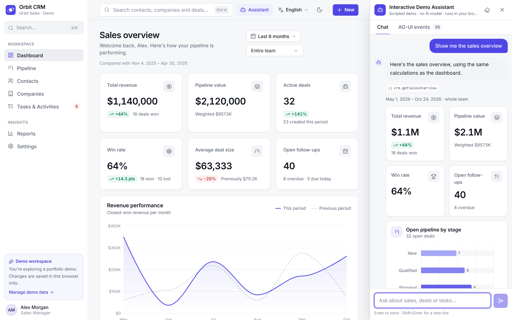
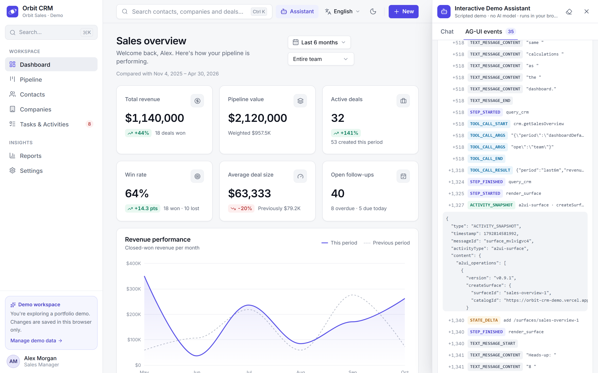
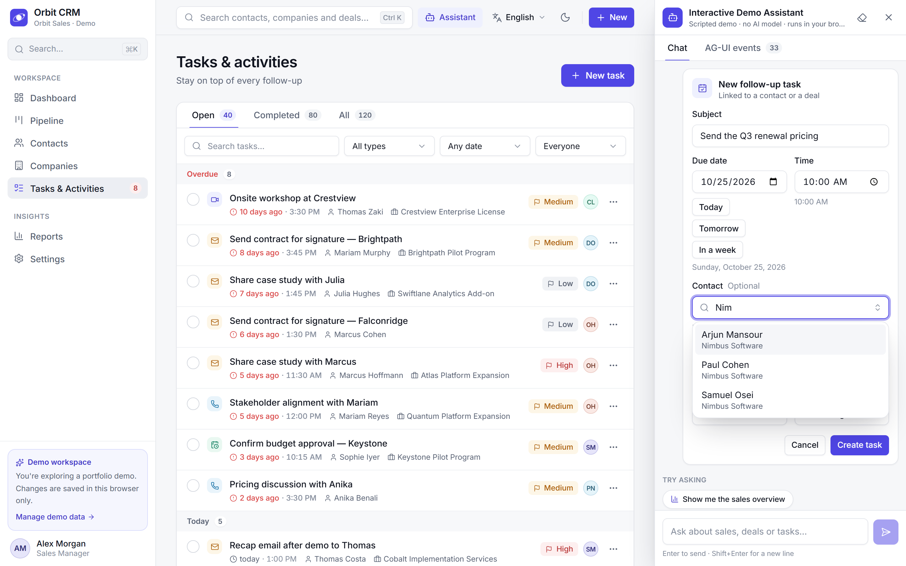
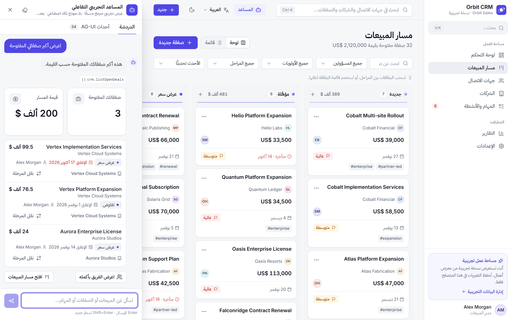
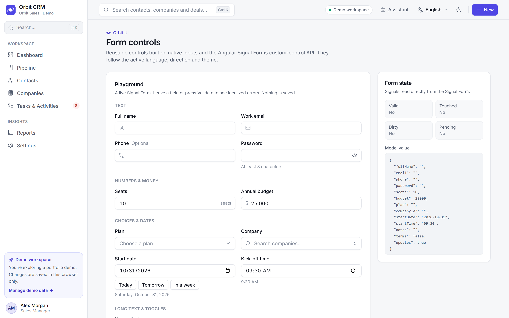
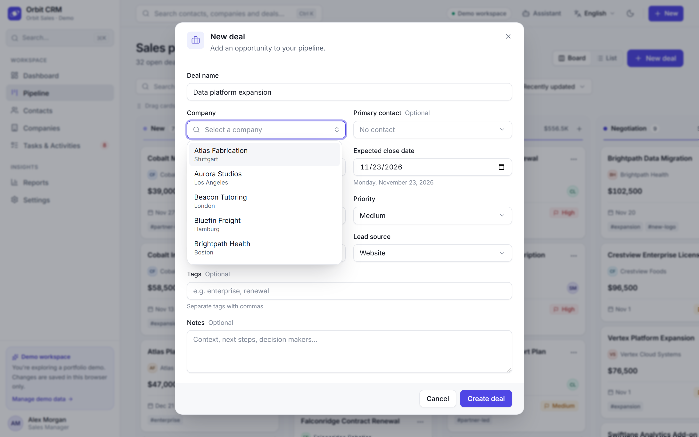

# Orbit CRM — Case Study

## Project overview

Orbit CRM is a modern sales workspace for small and mid-sized sales teams, agencies and the
managers who lead them. It brings the core of a CRM into one interface: an executive dashboard,
a Kanban sales pipeline, deal records, contacts and companies, follow-up tasks, and a reporting
area — in English, Arabic and French.

It was built as a portfolio project to demonstrate production-grade frontend engineering:
component architecture, reactive state management, data visualisation, internationalisation,
accessibility and visual design. It is an interactive frontend demo backed by a seeded local
dataset rather than a deployed multi-user product.

## The challenge

Sales teams juggle relationships across spreadsheets, inboxes and calendars. The questions that
matter — *What's in the pipeline? What did we close this quarter? Which follow-ups are overdue?
Who is on track against quota?* — are hard to answer when data is scattered or when reports are
static snapshots that drift from reality.

For the product to be credible, every number on screen had to be **derived from the same records**
that users edit. Moving a deal to *Won* must update revenue, win rate, monthly charts, team
attainment and the activity feed immediately — without a backend — and the experience had to
work equally well for an Arabic-speaking team reading right-to-left as for an English or French one.

## The solution

Orbit CRM keeps a single, typed, persisted dataset in the browser and treats every view as a
function of it:

- **Entity stores** cache companies, contacts, deals, activities and timeline events.
- **Domain commands** apply business rules once — closing a deal stamps its close date, losing one
  records the stage it was lost at, completing a task updates the contact's last interaction, and
  deleting a company unlinks (rather than deletes) its contacts and deals.
- **Pure analytics functions** turn records into KPIs and chart series, wrapped in computed
  signals so the UI updates the moment data changes.

The result behaves like a real application: edits persist across reloads, resetting restores the
original dataset, and corrupted storage is detected and repaired.

## Key features

- **Dashboard** — Total revenue, pipeline value (with weighted value), active deals, win rate,
  average deal size and open follow-ups, each with a period comparison when the data supports one.
  Revenue performance, pipeline by stage, lead sources, deals won per month, team quota attainment
  and a live activity feed — all filtered by date range and team member.
- **Pipeline** — six-stage Kanban with drag & drop, a "Move to" menu for keyboard and touch users,
  undo, search, owner/priority/stage filters, sort options and a list view.
- **Deal details** — clickable stage stepper, probability and weighted value, notes, linked tasks,
  company and contact cards, and a timeline.
- **Contacts & companies** — directories with search, filters, sorting and pagination; rich
  profiles with deals, tasks and activity; validated forms with duplicate detection.
- **Tasks & activities** — overdue / today / next 7 days / later grouping, one-click completion
  with undo, a weekly summary and a recently completed feed.
- **Reports** — revenue trend, cohort conversion funnel, pipeline analysis (total vs. weighted),
  deal-size distribution, salesperson performance and lead-source insights.
- **Settings** — theme (light/dark/system), reduced motion, language, workspace defaults, table
  density, dataset information, JSON export and demo reset.
- **Interactive Demo Assistant** — ask for a sales overview, your biggest open deals, overdue tasks,
  a follow-up task or a stage change, and get interactive cards built from live CRM data. It runs
  on the AG-UI and A2UI protocols, entirely in the browser, and is clearly labelled as a scripted
  demo with no AI model.
- **Orbit form controls** — one family of accessible controls behind every form and filter: text
  inputs, number and currency, textarea, custom dropdown, searchable select, date/time picker,
  checkbox and toggle. They are built on the Signal Forms custom-control API and shown at
  `/showcase`.

## Engineering approach

**Angular architecture.** Standalone components with OnPush change detection in a zoneless
application, feature-oriented folders, and lazy-loaded routes. Create/edit dialogs and the command
palette load on demand.

**Signal Stores.** Root entity stores are composed from a reusable NgRx SignalStore feature that
adds load state and optimistic create/update/delete with rollback. Feature view stores hold
filters, sorting and paging at root level so they survive navigation and language changes; all
derived values are computed.

**Data modelling.** Typed entities with stable enum values; translations never touch stored data.
Relationships are nullable where deletion can unlink them, and a validator repairs dangling
references, drops invalid records and handles outdated schema versions.

**Mock repositories.** UI code depends only on repository contracts (abstract classes used as
dependency-injection tokens). The demo binds them to a browser-storage implementation; an HTTP
implementation could be provided instead without changing components or stores.

**Chart derivation.** ECharts option builders receive data from computed store selectors and read
colours from the live CSS theme at render time, so charts react to data, theme and language
changes. Revenue comparisons are aligned bucket-by-bucket, and comparisons are suppressed when the
previous period isn't fully covered by recorded history.

**Deterministic seed.** A fixed-seed generator produces 8 team members, 30 fictional companies,
100 contacts, 80 deals, 120 activities and the timeline events that follow from them, anchored to
the day the workspace is first opened so the demo always looks current.

## Design decisions

- **Restrained, original visual language** — slate neutrals, an indigo accent, emerald/amber/red
  for status only, an 8 px spacing rhythm, subtle borders and shadows, and Inter with tabular
  figures for numbers.
- **Semantic tokens for both themes** — every colour is a CSS variable mapped into Tailwind, so
  dark mode is designed, not inverted.
- **Validated chart palette** — the categorical colours were checked for colour-vision-deficiency
  separation and contrast in light and dark modes; pipeline stages use an ordinal indigo ramp with
  status colours reserved for Won and Lost.
- **Semantics first** — buttons and inputs keep their native semantics. Dropdowns and searchable
  selects are custom controls that follow the ARIA combobox pattern, so they can match the design
  in every theme and direction. CDK supplies menus, dialogs, overlays and drag & drop.
- **Honest numbers** — when a comparison can't be computed from real data, the interface says so
  instead of inventing a trend.
- **States everywhere** — skeletons that match final layouts, purposeful empty states, toasts with
  undo, and a clear "Demo workspace" label so visitors know what they are exploring.

## Internationalization & RTL Engineering

**Why ngx-translate.** The product needed runtime language switching without rebuilding or
reloading, JSON dictionaries organised by feature that are easy to review, and a reactive API that
fits signals and OnPush components. Angular's compile-time i18n produces one build per locale,
which doesn't support instant switching while preserving application state.

**Runtime switching.** A `LanguageService` coordinates everything: it loads the target dictionary
first, then switches ngx-translate, updates `<html lang dir>`, notifies the CDK `Directionality`
(used by overlays and drag & drop) and persists the choice — in one step, so raw keys never flash.
It exposes signals (`code`, `locale`, `isRtl`) and reactive `t()` / `plural()` helpers used by
charts, toasts and page titles. Filters, open dialogs' underlying data and records are untouched.

**Persistence.** The language is saved under its own `localStorage` key, restored before the app
boots (an inline script sets `lang`/`dir` to avoid a flash), falls back to English for unsupported
values, and survives a demo-data reset.

**RTL layout.** Layout is written with CSS logical properties (`ps-*`, `me-*`, `start-*`,
`text-start`, `border-e`), so the sidebar, drawers, toasts, tables, pagination, stepper and
Kanban board mirror naturally. Direction-dependent icons (chevrons, back arrows, trends) flip;
emails, phone numbers and URLs render as isolated LTR islands; Arabic uses IBM Plex Sans Arabic
with letter-spacing disabled to protect letter joining. Plural rules use `Intl.PluralRules` with
all six Arabic CLDR categories.

**Translated charts.** Chart labels, legends, tooltips and empty states are produced inside
computed signals that read the active language, so ECharts re-renders on switch. In RTL, time
axes run right-to-left and value axes move to the right; charts render inside an LTR box so SVG
text anchors stay correct.

**Locale-aware formatting.** Dates, numbers, percentages, relative times, country names and
currency use `Intl` (Arabic pinned to the Gregorian calendar and Latin digits). Amounts always
stay in USD — switching language never converts values — and the Latin currency symbol is
wrapped in Unicode isolates so `US$` isn't reordered by the bidirectional algorithm.

**Testing multilingual behaviour.** A script and a unit test enforce identical keys across all
three dictionaries, complete plural categories and matching placeholders, and verify every key
used in code exists. Unit tests cover default language, RTL switching, persistence, fallback and
plural selection. E2E tests switch EN → AR → FR while checking direction, sidebar position,
preserved filters, translated chart text, dialogs, validation and toasts, the absence of English
strings in Arabic and French views, RTL drag & drop, unchanged monetary values and mobile layouts.

## Agentic UI: the Interactive Demo Assistant

**The goal.** Show how an agent-driven interface can be engineered safely — without pretending a
scripted demo is artificial intelligence. A visitor asks for a view, and the assistant answers
with interactive UI built from the same records the rest of the CRM shows.

**Two open protocols.**
- **AG-UI** carries the conversation: run lifecycle, streamed text, tool calls, state and
  activity events. The agent extends the official `AbstractAgent` from `@ag-ui/client`, so the
  client runtime verifies and applies the event stream exactly as it would for a remote agent.
- **A2UI v0.9.1** describes the UI: surfaces, component trees and data models as declarative JSON.
  An Angular catalog of 16 Orbit components renders them. They reuse the app's form controls and
  chart container, so a surface looks native, follows the theme and mirrors in Arabic.

**Deterministic by design.** A rules-based matcher with a phrase and keyword catalogue in English,
Arabic and French routes requests. Anything outside the catalogue gets an honest "I didn't
recognise that" and the list of supported requests. No language model, API key or backend is
involved, so the demo is free, private and fully testable. Network latency is simulated, because
a real agent's first event is never instant.

**Trust boundaries.** Zod validates everything that crosses a boundary: the intent catalogue,
scenario fixtures, run input, every A2UI payload (protocol version, catalog id, an allowlist of
component types with strict props, size limits) and every user action. Malformed surfaces are
blocked before the renderer sees them, and you can ask the assistant to demonstrate that. Writes
go through allowlisted CRM commands. Moving a deal needs an explicit confirmation that must match
the reviewed change, and it can be undone.

**Transparency.** An *AG-UI events* tab lists every event of every run, with timings, payloads and
schema validity, plus the agent's shared state.

**Cost.** The assistant, AG-UI, A2UI and Zod form one lazy chunk (≈ 167 kB transferred) that
loads only when the assistant first opens. Details, event flow and protocol examples are in
[`docs/AGENTIC_DEMO.md`](../docs/AGENTIC_DEMO.md).

## Technical highlights

- Reactive end-to-end: dragging a deal to *Won* updates revenue, win rate, charts, quota
  attainment and the feed instantly, with undo.
- Reusable optimistic-CRUD SignalStore feature with rollback.
- Repository contracts that isolate the UI from persistence.
- Versioned persistence with validation, repair and recovery.
- Cohort-based conversion funnel using the stage at which lost deals were lost.
- Full RTL support with mirrored charts and bidi-safe formatting.
- Keyboard-accessible alternatives for drag & drop, roving-tabindex tabs that follow reading
  direction, focus management and reduced-motion support.
- Signal Forms custom controls (`FormValueControl` / `FormCheckboxControl`) with localized errors,
  ARIA combobox dropdowns and stable test ids, used by every form and filter.
- A protocol-based agentic UI (AG-UI events → Zod-validated A2UI → Angular catalog) with
  allowlisted, confirmable and undoable writes.
- Page layouts use container-query breakpoints, so they reflow correctly beside the docked
  assistant panel.
- Initial bundle of ≈ 591 kB raw (≈ 160 kB transferred). ECharts and the assistant are lazy chunks.

## Testing and quality

- TypeScript strict mode and angular-eslint (including template accessibility rules) pass.
- 126 unit tests (Vitest) cover metric definitions, comparability rules, domain rules, the seed,
  persistence/reset/recovery, CRUD and cascades, the language service, dictionary parity,
  formatting, form validation in three languages, and the form controls. For the assistant they
  cover schemas, routing, AG-UI event ordering and validity, cancellation, latency and CRM actions.
- 32 Playwright E2E tests run against the production build on desktop and mobile viewports.
  `E2E_BASE_URL` points the same suite at a deployed site. Each test fails on any browser console
  error.
- The interface was reviewed visually at 1440, 768 and 390 px widths in English, Arabic and French
  and in dark mode; overflow, clipping and RTL issues found during review were fixed.

## Screenshots

| Desktop | |
| --- | --- |
|  |  |
|  |  |
|  |  |
|  |  |
|  |  |
|  | |

| Assistant & form controls | |
| --- | --- |
|  |  |
|  |  |

Mobile: [dashboard](screenshots/08-mobile-dashboard.png) ·
[pipeline](screenshots/09-mobile-pipeline.png) · [Arabic RTL](screenshots/15-mobile-arabic-rtl.png) ·
[assistant](screenshots/20-mobile-assistant.png)

## Demo

- **Live demo** — [orbit-crm-demo.vercel.app](https://orbit-crm-demo.vercel.app) (deployed on
  Vercel from the GitHub repository).
- **Product walkthrough** — [`videos/orbit-crm-walkthrough.mp4`](videos/orbit-crm-walkthrough.mp4)
  (1920×1080, 30 fps, 127 s):
  - dashboard and analytics, reports, dragging a deal to *Won* and seeing the dashboard update,
    contacts, task completion;
  - the demo assistant: a sales overview surface, creating a follow-up through a validated form,
    and the AG-UI event inspector;
  - the custom form controls in the deal form;
  - English → Arabic → French, mobile layout and dark mode.

  Poster: [`cover/orbit-crm-video-poster.png`](cover/orbit-crm-video-poster.png).
- **Social short** — [`videos/orbit-crm-short.mp4`](videos/orbit-crm-short.mp4) (1080×1920,
  30 fps, 35 s): mobile dashboard, moving a deal, the assistant as a full-screen drawer, switching
  to Arabic RTL and dark mode.

Both videos were recorded from the running production build with scripted browser automation;
captions and the pointer are overlays drawn outside the application.

## Limitations

Orbit CRM is a frontend-only interactive demonstration using local seeded data. It is deployed as
a static site, but it is not a multi-user production CRM: there is no backend, authentication, permissions, real-time
collaboration or server-side validation, and data is stored in a single browser's `localStorage`.
All companies, people and figures are fictional, and no performance numbers, customer outcomes or
business results are claimed. The demo assistant is scripted: it recognises a fixed catalogue of
requests and uses no AI model.
